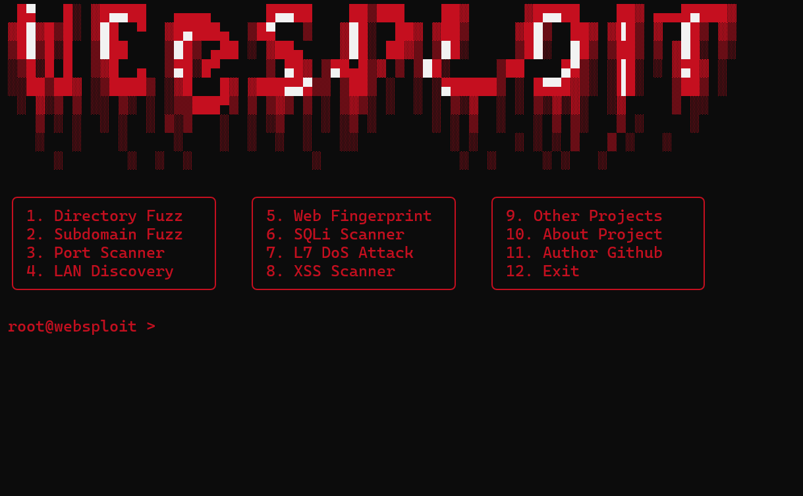

<h1 align="center">FSOCIETY</h1>

<p align="center">
  
</p>

Educational cybersecurity application built with Python and Flet. Desktop and Android (APK) support.

For educational purposes only. Author not responsible for misuse.

## Installation

```bash
pip install -r requirements.txt
```

## Run

```bash
python fsociety.py
```

## Quick Start

Too lazy to remember two commands?

```bash
python launch.py
```

It installs dependencies and launches the application automatically.


## requirements.txt
```bash
flet==0.84.0
aiohttp
requests
phonenumbers
```
## Preview

**FSOCIETY** - Educational project
